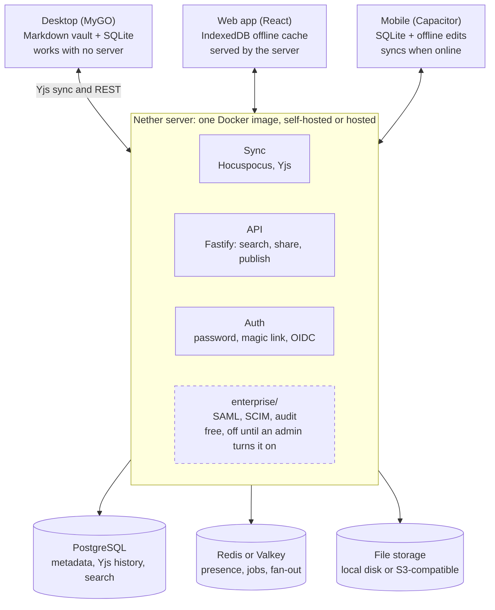

# Architecture

Nether is a TypeScript monorepo: one shared core runs in every client, each
client keeps a local database and works offline, and an optional server
syncs CRDT updates between them. Clients talk to the server only to sync
and share. The [decision records](adr/) say why each part was chosen.

## Stack

| Layer | Choice | Decided in |
| --- | --- | --- |
| Language | TypeScript for the web, mobile and server apps and the shared packages; Go for the desktop app's native side | [0004](adr/0004-desktop-on-mygo.md) |
| Monorepo | pnpm workspaces and Turborepo | |
| Editor | TipTap 3 on ProseMirror; CodeMirror 6 for source mode | [0002](adr/0002-editor-tiptap.md) |
| Markdown | remark and micromark, with Nether's extensions for Obsidian's syntax | [0002](adr/0002-editor-tiptap.md) |
| Real-time data model | Yjs: one document per note, one per vault | [0003](adr/0003-sync-yjs-hocuspocus.md) |
| Sync server | Hocuspocus, inside the server's Node service | [0003](adr/0003-sync-yjs-hocuspocus.md) |
| Server framework | Fastify | [0005](adr/0005-server-on-fastify.md) |
| Server database | PostgreSQL 16 or later: metadata, permissions, Yjs updates, full-text search | |
| Cache and pub/sub | Redis or Valkey: presence, sync fan-out across nodes, job queue | |
| File storage | Local disk or any S3-compatible store (MinIO, R2, S3) | |
| Client storage | SQLite with FTS5; on the desktop, Markdown files in the vault too | [0003](adr/0003-sync-yjs-hocuspocus.md) |
| Desktop | MyGO, its main window a web page with the shared UI | [0004](adr/0004-desktop-on-mygo.md) |
| Mobile | Capacitor, reusing the web UI | |
| Web | React and Vite | |
| Graph view | Sigma.js or Cytoscape.js, chosen in Phase 2 | |
| Canvas | The open JSON Canvas format | |
| Server search | PostgreSQL full-text search, with an optional Meilisearch adapter | |
| Sign-in | Email and password, magic links, OIDC; SAML as an enterprise feature | |
| Deployment | A Docker image with Compose, and a Helm chart for Kubernetes | |
| License | AGPL-3.0-or-later for everything, contributions under the DCO | [0001](adr/0001-license-agpl-and-dco.md) |

## Data model

- Every note has a stable ID, independent of its title and file path, so
  renames never break links.
- On the desktop, each note is mirrored to a `.md` file in the user's
  vault folder. Edits made to that file by other apps are detected and
  merged into the note's CRDT ([ADR 0003](adr/0003-sync-yjs-hocuspocus.md)).
- Every block has a stable ID, so it can be linked, embedded and commented
  on.
- A database is a note with a schema, and its rows are notes with
  properties: everything stays a note, as in Obsidian, while databases
  work as in Notion.
- A vault, also called a workspace, is the unit of sync, permission and
  encryption.

## Repository layout

| Folder | What it holds |
| --- | --- |
| [`apps/desktop`](../apps/desktop/) | The desktop app (MyGO) |
| [`apps/web`](../apps/web/) | The web client (React and Vite) |
| [`apps/mobile`](../apps/mobile/) | The iOS and Android apps (Capacitor) |
| [`apps/server`](../apps/server/) | The API and sync server |
| [`apps/docs-site`](../apps/docs-site/) | The user and admin documentation |
| [`packages/core`](../packages/core/) | The data model: notes, blocks, properties, databases, views, links, workspaces |
| [`packages/editor`](../packages/editor/) | The block and Markdown editor |
| [`packages/markdown`](../packages/markdown/) | Markdown to and from Nether's documents, frontmatter, import and export |
| [`packages/storage`](../packages/storage/) | Local SQLite and the vault file watcher |
| [`packages/sync-client`](../packages/sync-client/) | The Yjs provider, the offline queue, end-to-end encryption |
| [`packages/database`](../packages/database/) | Database views, filters, formulas, relations |
| [`packages/search`](../packages/search/) | Indexing and queries |
| [`packages/graph`](../packages/graph/) | The link index, backlinks and the graph view |
| [`packages/canvas`](../packages/canvas/) | The whiteboard, in the JSON Canvas format |
| [`packages/plugin-api`](../packages/plugin-api/) | The public, versioned plugin SDK |
| [`packages/ai`](../packages/ai/) | The provider-agnostic AI adapter |
| [`packages/ui`](../packages/ui/) | Shared components, themes and design tokens |
| [`enterprise`](../enterprise/) | SSO, SCIM, audit logs, policies, the admin console, high availability: free, same license |
| [`deploy`](../deploy/) | The Docker image, Compose file and Helm chart |
| [`docs/adr`](adr/) | Architecture Decision Records |
