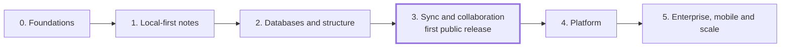

# Roadmap

Nether ships in six phases. Each one ends with a usable app and a gate, a
test that must pass before the next phase starts. Phase numbers match the
Phase column of the [requirements](requirements.md). Phases have no fixed
dates; the maintainer sets them after Phase 0.

| Phase | Scope | Gate |
| --- | --- | --- |
| 0. Foundations | First ADRs, monorepo scaffold, CI, license setup, core data model, 50,000-note test vault | CI is green, including a server run with every enterprise feature off |
| 1. Local-first notes (the Obsidian core) | Vault on disk, block and Markdown editor, links, backlinks, tags, search, templates, export, desktop app | A 50,000-note vault edits offline within the [performance targets](requirements.md#non-functional-requirements) |
| 2. Databases and structure (the Notion core) | Databases, six views, relations, rollups, formulas, synced blocks, graph view, themes, importers | An Obsidian vault and a Notion export import with no lost text |
| 3. Self-hosted sync and collaboration (first public release) | Server, end-to-end encrypted sync, history, co-editing, comments, permissions, web app, canvas, backups | `docker compose up` works; two users co-edit offline and online with no lost edits |
| 4. Platform | Plugin API and sandbox, bring-your-own AI, share links, web publishing, REST API, web clipper, automations | Third-party plugins run sandboxed; a published site loads on a custom domain |
| 5. Enterprise, mobile and scale | Free enterprise features (SSO, SCIM, audit logs, data policies, high availability), Helm chart, mobile apps, integrations | A self-hosted install runs air-gapped with SSO and audit logs on, and no license key |

Phase 3 is the first public release, because sync and self-hosting are
what set Nether apart from both Notion and Obsidian.

## How a phase runs

- One phase at a time, and inside a phase one feature at a time. Each
  feature is one branch and one pull request, whose description starts
  with a plan: the requirement, the design, the files it touches and how
  it is tested.
- Significant decisions become [Architecture Decision Records](adr/).
- At the end of each phase a short report says what shipped, what was
  deferred, the known issues, and the plan for the next phase.

## Phase 0: Foundations

Done on 2026-10-30; the [report](reports/phase-0.md) says what shipped,
what was deferred and the plan for Phase 1.

- [x] ADR 0001: one license for the whole repository, and the DCO for contributions
- [x] ADR 0002: the editor library, with a spike comparing Markdown round trips
- [x] ADR 0003: the CRDT and sync approach, and how Markdown files on disk stay in step with it
- [x] ADR 0004: the desktop app on MyGO
- [x] The monorepo: pnpm, Turborepo, strict TypeScript, ESLint, Prettier, Vitest, Playwright
- [x] CI: lint, types, tests, license scan, desktop and server builds, and a server run with every enterprise feature off
- [x] `LICENSE`, `README.md`, `CONTRIBUTING.md`, `SECURITY.md`, `CODE_OF_CONDUCT.md`
- [x] The core data model: note, block, property, database, view, link and workspace, with stable IDs and serialization tests
- [x] A generator of the reference 50,000-note vault for the performance tests

## Phase 1: Local-first notes

Done on 2026-10-31; the [report](reports/phase-1.md) says what shipped,
what was deferred and the plan for Phase 2.

The Obsidian core, one feature per pull request, in this order:

- [x] `packages/markdown`: Markdown to and from Nether's notes, with Obsidian's syntax and a round trip that keeps unchanged blocks byte for byte ([ADR 0006](adr/0006-markdown-file-format.md))
- [x] The vault on disk: reading, writing and watching the folder, and the local SQLite store ([ADR 0007](adr/0007-vault-folder-and-local-index.md))
- [x] `packages/editor`: the block editor with live Markdown shortcuts, the slash menu, block handle and rich blocks, embeds of images, PDFs, audio and video, and source mode (web link previews, and embeds of notes and blocks, come with links)
- [x] Yjs documents per note, kept in step with the files both ways
- [x] Links, backlinks, aliases, tags and the outline: the link index, `[[` links and aliases, heading and block links, the backlinks panel, tags, the outline, and embeds of notes and blocks (making a block link from `[[`, and updating links when a note is renamed, come with renaming in the app's interface)
- [x] The quick switcher and full-text search
- [x] Properties: typed properties above each note, kept in its Yjs document and its frontmatter
- [x] Templates and daily, weekly and monthly notes, with Obsidian's variables and settings ([ADR 0011](adr/0011-templates-and-periodic-notes.md))
- [x] The trash: restore where a note was, and deletion for good after 30 days or as set
- [x] Export: notes, folders and the vault to Markdown (ZIP), HTML and PDF ([ADR 0012](adr/0012-export-from-the-page.md)); databases to CSV come with databases in Phase 2
- [x] Renaming and moving notes, with every link to them rewritten
- [x] Folders and nested pages in the sidebar: the file tree and the page tree ([ADR 0013](adr/0013-pages-in-the-folder-beside-a-note.md))
- [x] The command palette, Ctrl/Cmd+P, and a shortcut for every action
- [x] Block links made from `[[`, writing the block's `^id` into its note
- [x] Previews of web links, fetched only when asked
- [x] The desktop packages: AppImage, deb and Flatpak on Linux, and updates that can be turned off (they start once a maintainer adds the update key)
- [x] The performance harness on the reference vault, which the gate runs ([tools/perf](../tools/perf/), [ADR 0014](adr/0014-load-a-vaults-links-lean-and-after-its-note.md))
- [x] Accessibility: every screen checked against WCAG 2.2 AA in the end-to-end tests, and the layout right to left ([ADR 0015](adr/0015-check-accessibility-and-lay-out-by-direction.md))

## Phase 2: Databases and structure

The Notion core, one feature per pull request, in this order:

- [x] Opening a vault at a note its command line names, which the desktop app's measurements start at (carried over from Phase 1)
- [x] `packages/database`: a database as a note with a schema, its rows as notes with properties, and how both are stored as Markdown and frontmatter ([ADR 0018](adr/0018-a-database-is-a-note-with-an-obsidian-base-beside-it.md))
- [x] The table view, with each view's filters, sorts, grouping and visible properties
- [x] The Obsidian base beside each database, written from its schema, with Obsidian's edits read back
- [x] The board, list and gallery views
- [x] The calendar and timeline views
- [x] Relations between databases, both ways, and rollups ([ADR 0019](adr/0019-relations-are-links-both-ways-and-rollups-are-worked-out.md))
- [x] Formulas: a documented, sandboxed expression language ([ADR 0020](adr/0020-formulas-in-a-language-nether-reads-and-runs-itself.md))
- [x] Query blocks: a live table or list of the notes a folder, tag or property finds ([ADR 0021](adr/0021-query-blocks-are-obsidian-bases-in-a-code-block.md))
- [x] Databases exported to CSV ([ADR 0022](adr/0022-a-database-exports-to-csv-as-its-view-shows-it.md))
- [x] Synced blocks: one block embedded in several notes, the same everywhere ([ADR 0023](adr/0023-synced-blocks-are-block-embeds-edited-in-place.md))
- [x] Unlinked mentions, each made a link in one click ([ADR 0024](adr/0024-unlinked-mentions-found-by-the-index-and-linked-where-written.md))
- [x] The graph view, global and local, filtered by tag, folder and property, smooth at 10,000 notes ([ADR 0025](adr/0025-graph-view-with-sigma-and-forceatlas2-in-a-worker.md))
- [x] Themes and CSS snippets ([ADR 0026](adr/0026-themes-and-snippets-are-css-files-of-the-vault.md))
- [ ] Importers: Obsidian vaults, Notion exports, Logseq, plain Markdown, HTML and CSV
